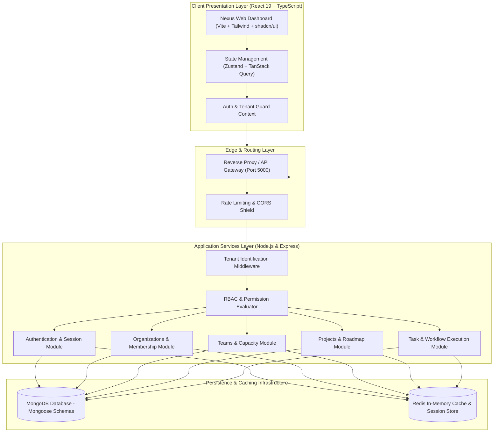

# Multi-Tenant Team Management Platform

<div align="center">

[](LICENSE)
[](https://react.dev/)
[](https://www.typescriptlang.org/)
[](https://nodejs.org/)
[](https://expressjs.com/)
[](https://www.mongodb.com/)
[](https://redis.io/)
[](https://www.docker.com/)

**An enterprise-grade, multi-tenant B2B SaaS platform engineered for managing organizations, cross-functional teams, projects, sprints, tasks, and agile workflows.**

[Architecture](#-system-architecture) • [Features](#-key-features) • [Tech Stack](#-technology-stack) • [API Specification](#-rest-api-specification) • [Getting Started](#-getting-started) • [Deployment](#-docker--production-deployment)

</div>

---

## 📌 Executive Overview

**Multi-Tenant Team Management** is a production-ready cloud software suite designed for modern engineering, product, and enterprise teams. Built with a strict **Tenant Isolation Architecture**, it delivers complete logical data separation across organizations while empowering teams with sprint roadmaps, kanban execution boards, team capacity tracking, daily standup blockers, audit logging, and role-based access control (RBAC).

### Core Philosophy: **No Project → No Task**
Every operational task belongs to an explicit project scope within a verified organizational or personal workspace boundary:
$$\text{Workspace} \longrightarrow \text{Project} \longrightarrow \text{Team / Members} \longrightarrow \text{Tasks} \longrightarrow \text{Execution} \longrightarrow \text{Delivery}$$

---

## 🏗 System Architecture

The platform follows a clean decoupled client-server architecture with multi-layer tenant resolution and role-based middleware enforcement.



---

## 🔐 Multi-Tenancy & Security Model

### 1. Dual-Workspace Paradigm
- **Personal Workspace**: Private workspace automatically provisioned for every authenticated user for personal task execution and exploratory project tracking.
- **Organization Workspace**: Enterprise-grade multi-tenant workspace with dedicated organization branding, role matrices, custom URL slugs (`app.domain.com/:org_slug`), member invitation links, and team groupings.

### 2. Tenant Data Isolation Strategy
- All tenant-scoped resources (`teams`, `projects`, `tasks`, `memberships`) enforce a mandatory indexed foreign key (`organizationId`).
- Data access layers execute tenant-scoped query filters at the database level to mathematically eliminate cross-tenant data leakage.

### 3. Role-Based Access Control (RBAC) Hierarchy

| Role Code | Role Name | Scope | Permissions & Capabilities |
| :--- | :--- | :--- | :--- |
| `SUPER_ADMIN` | Platform Operator | Global Platform | Cross-tenant visibility, audit enforcement, platform-level governance. |
| `ORG_OWNER` | Organization Owner | Tenant Scope | Full billing, organization settings, role delegation, domain binding, member offboarding. |
| `ORG_ADMIN` | Organization Administrator | Tenant Scope | Team creation, project approval, user invitations, departmental management. |
| `PROJECT_LEAD` | Project Lead | Project Scope | Sprint cadence setup, task assignment, milestone scheduling, delivery burndown. |
| `MEMBER` | Team Member | Project/Team Scope | Task execution, daily blocker reporting, comment threads, workload logs. |
| `GUEST` | External Stakeholder | Restricted Scope | Read-only roadmap reviews, status report observability. |

---

## ⚡ Key Features

### 🏢 Multi-Organization & Tenant Operations
- **Dynamic Organization Switcher**: Seamlessly switch between active organizations and personal workspaces without re-authenticating.
- **Tokenized Member Invitations**: Generate time-limited, cryptographically signed invitation links with predefined tenant roles.
- **Organization Preferences**: Custom time zones, date/time formats, working week start days, and avatar generation.

### 📊 Sprint Roadmaps & Execution
- **Visual Kanban Boards**: Drag-and-drop task card pipeline with automated state transitions (`Backlog`, `In Progress`, `Review`, `Done`).
- **Sprint Roadmaps & Gantt Milestones**: Timeline forecasting, sprint burndown telemetry, and deadline risk detection.
- **Subtask Decompositions**: Checklist breakdowns, progress calculation percentages, and dependency blocking.

### 👥 Teams & Workload Balancing
- **Team Allocation**: Group members into specialized squads (e.g., Frontend, Backend, Product Design, QA).
- **Workload Heatmaps**: Observe member task density and prevent team burnout through balanced sprint distribution.

### 🛡 Enterprise Security & Reliability
- **Stateless JWT + Secure HTTP-Only Cookies**: Protected authentication tokens fortified against XSS and CSRF vectors.
- **Password Hashing**: Industry-standard `bcrypt` salted password derivation.
- **Structured Error Handling**: Centralized error middleware with standardized RFC 7807 machine-readable JSON payloads.

---

## 💻 Technology Stack

```
├── Frontend (Client Layer)
│   ├── Framework:        React 19 (Concurrent Features, Transitions)
│   ├── Build Tool:       Vite 6 (ESM, Lightning Fast HMR)
│   ├── Language:         TypeScript 5.7 (Strict Mode)
│   ├── Component UI:     shadcn/ui + Radix UI Primitives
│   ├── Styling:          Tailwind CSS v4 + Vanilla CSS Design Tokens
│   ├── State & Data:     Zustand + TanStack React Query v5
│   ├── Icons & Visuals:  Lucide React + Iconify
│   └── Charts:           ApexCharts + React-ApexCharts
│
├── Backend (Service Layer)
│   ├── Runtime:          Node.js (LTS v20+)
│   ├── Web Server:       Express.js 5.x (Modular Router)
│   ├── Language:         JavaScript (ES6+) with TypeScript Type Definitions
│   ├── Database Driver:  Mongoose 9.x (Strict Validation, Hooks, Indexing)
│   ├── Auth & Crypto:    JSONWebToken (JWT) + bcrypt + cookie-parser
│   ├── Validation:       Express modular parameter & body sanitizers
│   └── Dev Tooling:      Nodemon + TSX
│
└── Infrastructure & Storage
    ├── Database:         MongoDB (Replica Set / Document Database)
    ├── In-Memory:        Redis (Fast Cache, Session Store, Rate Limiter)
    └── Containerization: Docker + Docker Compose Multi-Stage Builds
```

---

## 📂 Repository & Branch Architecture

This repository is maintained as a unified full-stack codebase with dedicated branch workflows:

| Branch Name | Primary Function | Contents |
| :--- | :--- | :--- |
| `main` | Production Release | Stable merged codebase, infrastructure configs, release manifests. |
| `dev-frontend` | Frontend Development | React 19 application, UI component library, theme tokens, client mock handlers. |
| `dev-backend` | Backend Development | Express REST APIs, Mongoose data models, RBAC middlewares, auth services. |

```
multi-tenant-team-management/
├── slash-admin-main/               # Frontend Application (React 19 + TypeScript)
│   ├── src/
│   │   ├── api/                    # Typed Axios client & service bindings
│   │   ├── components/             # Reusable UI system (Logo, Nav, Dialogs, Tables)
│   │   ├── layouts/                # Dashboard, mobile, and responsive layouts
│   │   ├── pages/                  # Page routes (Workbench, Projects, SaaS Settings, Login)
│   │   ├── store/                  # Zustand stores (Auth, Multi-Tenant Store, Settings)
│   │   └── theme/                  # Theme tokens, dark/light mode configurations
│   ├── package.json
│   └── vite.config.ts
│
└── Project Manange/                # Backend API Services (Node.js + Express + MongoDB)
    ├── src/
    │   ├── config/                 # Database connection & environment loaders
    │   ├── middleware/             # Auth guard, RBAC checker, centralized error handler
    │   ├── modules/
    │   │   ├── auth/               # Sign-in, sign-up, JWT token issuance
    │   │   ├── organizations/      # Tenant lifecycle, slugs, settings
    │   │   ├── memberships/        # Organization user associations & role assignments
    │   │   ├── teams/              # Departmental team groupings & membership
    │   │   ├── projects/           # Project roadmaps, sprints, project lead assignees
    │   │   ├── tasks/              # Task state machine, priority, assignment, blockers
    │   │   └── users/              # User profiles, avatar metadata, credentials
    │   ├── app.js                  # Express app initialization & route registration
    │   └── server.js               # HTTP server bootstrap & graceful shutdown
    └── package.json
```

---

## 📡 REST API Specification

### 1. Authentication (`/api/auth`)
| Method | Endpoint | Description | Access Level |
| :--- | :--- | :--- | :--- |
| `POST` | `/api/auth/signup` | Register new user account | Public |
| `POST` | `/api/auth/signin` | Authenticate user & issue JWT cookie/token | Public |
| `POST` | `/api/auth/logout` | Invalidate active session & clear cookies | Authenticated |
| `GET` | `/api/auth/me` | Fetch currently authenticated user context | Authenticated |

### 2. Organizations & Tenants (`/api/organizations`)
| Method | Endpoint | Description | Access Level |
| :--- | :--- | :--- | :--- |
| `GET` | `/api/organizations` | List all organizations current user belongs to | Authenticated |
| `POST` | `/api/organizations` | Create a new tenant organization workspace | Authenticated |
| `GET` | `/api/organizations/:id` | Retrieve organization configuration & metadata | Tenant Member |
| `PATCH` | `/api/organizations/:id` | Update organization settings, slug, or profile | `ORG_OWNER`, `ORG_ADMIN` |
| `DELETE` | `/api/organizations/:id` | Soft-delete or decommission organization tenant | `ORG_OWNER` |

### 3. Memberships & RBAC (`/api/memberships`)
| Method | Endpoint | Description | Access Level |
| :--- | :--- | :--- | :--- |
| `GET` | `/api/memberships/org/:orgId` | List members & assigned roles for an organization | Tenant Member |
| `POST` | `/api/memberships/invite` | Issue membership invitation to email address | `ORG_ADMIN`+ |
| `PATCH` | `/api/memberships/:id/role` | Change member role (`MEMBER`, `ADMIN`, etc.) | `ORG_OWNER` |
| `DELETE` | `/api/memberships/:id` | Revoke organization access / remove member | `ORG_ADMIN`+ |

### 4. Teams (`/api/teams`)
| Method | Endpoint | Description | Access Level |
| :--- | :--- | :--- | :--- |
| `GET` | `/api/teams/org/:orgId` | List teams inside an organization | Tenant Member |
| `POST` | `/api/teams` | Create departmental team squad | `ORG_ADMIN`+ |
| `PATCH` | `/api/teams/:id` | Update team details or department lead | `ORG_ADMIN`+ |
| `DELETE` | `/api/teams/:id` | Delete team grouping | `ORG_ADMIN`+ |

### 5. Projects (`/api/projects`)
| Method | Endpoint | Description | Access Level |
| :--- | :--- | :--- | :--- |
| `GET` | `/api/projects/org/:orgId` | List active projects for organization | Tenant Member |
| `POST` | `/api/projects` | Provision new project within workspace | `ORG_ADMIN`, `PROJECT_LEAD` |
| `GET` | `/api/projects/:id` | Retrieve project details, milestones, and members | Project Member |
| `PATCH` | `/api/projects/:id` | Modify project schedule, state, or Project Lead | `PROJECT_LEAD`+ |

### 6. Tasks (`/api/tasks`)
| Method | Endpoint | Description | Access Level |
| :--- | :--- | :--- | :--- |
| `GET` | `/api/tasks/project/:projectId` | Fetch project task backlog and Kanban board | Project Member |
| `POST` | `/api/tasks` | Create task within designated project | Project Member |
| `PATCH` | `/api/tasks/:id/status` | Update task status (`BACKLOG` → `IN_PROGRESS` → `DONE`) | Assignee / Lead |
| `PATCH` | `/api/tasks/:id` | Update task title, description, priority, or dates | Assignee / Lead |
| `DELETE` | `/api/tasks/:id` | Delete or archive task | `PROJECT_LEAD`+ |

---

## 🚀 Getting Started

### Prerequisites
Make sure your development machine has the following tools installed:
- **Node.js**: v18.x or v20.x LTS
- **pnpm** (recommended for frontend) or **npm**
- **MongoDB**: Local MongoDB instance (v6.x+) or MongoDB Atlas connection string
- **Redis** *(Optional for local dev, recommended for production caching)*
- **Git**

---

### Step 1: Clone Repository & Switch Branches

```bash
git clone https://github.com/nagaarjunan/multi-tenant-team-management.git
cd multi-tenant-team-management
```

To work with the frontend:
```bash
git checkout dev-frontend
```

To work with the backend:
```bash
git checkout dev-backend
```

---

### Step 2: Backend Setup (`Project Manange`)

1. Navigate to the backend directory:
   ```bash
   cd "Project Manange"
   ```

2. Install dependencies:
   ```bash
   npm install
   ```

3. Configure environment variables:
   ```bash
   cp .env_samples .env
   ```
   Customize values in `.env`:
   ```env
   PORT=5000
   MONGO_URI=mongodb://127.0.0.1:27017/project_manage
   JWT_SECRET=super_secure_production_jwt_secret_key_987654321
   JWT_EXPIRES_IN=7d
   CLIENT_URL=http://localhost:3001
   NODE_ENV=development
   ```

4. Launch backend development server:
   ```bash
   npm run dev
   ```
   *The backend API will initialize at `http://localhost:5000`.*

---

### Step 3: Frontend Setup (`slash-admin-main`)

1. Open a new terminal and navigate to the frontend directory:
   ```bash
   cd "slash-admin-main"
   ```

2. Install dependencies:
   ```bash
   pnpm install
   # or: npm install
   ```

3. Configure environment variables:
   Create or verify `.env`:
   ```env
   VITE_APP_PUBLIC_PATH=/
   VITE_APP_DEFAULT_ROUTE=/workbench
   VITE_APP_API_BASE_URL=/api
   ```

4. Start Vite development server:
   ```bash
   npm run dev
   ```
   *The frontend dashboard will run at `http://localhost:3001` with instantaneous HMR.*

---

## 🐳 Docker & Production Deployment

A standardized multi-container Docker Compose configuration provides container parity between local environments and cloud deployments:

```yaml
version: "3.8"

services:
  mongodb:
    image: mongo:7-jammy
    container_name: nexus-mongodb
    restart: always
    ports:
      - "27017:27017"
    environment:
      MONGO_INITDB_DATABASE: project_manage
    volumes:
      - mongo_data:/data/db

  redis:
    image: redis:7-alpine
    container_name: nexus-redis
    restart: always
    ports:
      - "6379:6379"

  backend:
    build:
      context: ./"Project Manange"
      dockerfile: Dockerfile
    container_name: nexus-backend
    restart: always
    ports:
      - "5000:5000"
    environment:
      PORT: 5000
      MONGO_URI: mongodb://mongodb:27017/project_manage
      JWT_SECRET: production_docker_secret_key
      CLIENT_URL: http://localhost:3001
    depends_on:
      - mongodb
      - redis

  frontend:
    build:
      context: ./"slash-admin-main"
      dockerfile: Dockerfile
    container_name: nexus-frontend
    restart: always
    ports:
      - "3001:80"
    depends_on:
      - backend

volumes:
  mongo_data:
```

To run the entire ecosystem with a single command:
```bash
docker compose up -d --build
```

---

## 🔒 Security Best Practices Implemented

- **Parametric Query Sanitization**: Prevents NoSQL injection by ensuring MongoDB queries operate through strict typed Mongoose schemas.
- **Tenant Scope Guardrails**: Every update and delete operation mandates an explicit `organizationId` filter constraint.
- **CSRF & XSS Mitigation**: Authentication cookies configured with `SameSite=Strict` and `HttpOnly`.
- **Timing Safe Password Comparisons**: Employs constant-time cryptographic hash verification via `bcrypt`.

---

## 🤝 Contributing & Code Guidelines

1. **Fork the Repository** and create your branch from `dev-frontend` or `dev-backend`.
2. **Commit Convention**: Follow Conventional Commits:
   - `feat(scope): add sprint velocity chart`
   - `fix(rbac): enforce project lead boundary on task delete`
   - `docs(api): update membership invite schemas`
3. **Open a Pull Request** against the target development branch with detailed testing notes.

---

## 📄 License

This project is licensed under the **MIT License** — feel free to use, modify, and distribute for commercial and open-source applications.

---

<div align="center">
  <sub>Engineered with precision for modern agile organizations worldwide.</sub>
</div>
